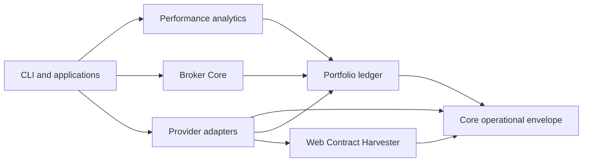

# System boundaries

This document defines the target architectural boundaries for `quant_engine`.
It is normative for dependency direction and interface ownership, but it is not
evidence that a component has been implemented or accepted. The governing
GitHub Issue and its checks provide that evidence.

## System context

`quant_engine` coordinates four distinct responsibilities:

1. **Provider acquisition** — API, HAR-derived contracts, Flex statements, and
   static-file adapters acquire immutable source evidence.
2. **Canonical portfolio ledger** — provider facts map into stable account,
   security, strategy, transaction, position, cash-flow, NAV, allocation, and
   reconciliation records.
3. **Performance and control** — accepted ledger generations produce
   account-by-strategy performance, coverage, data-quality findings, allocation
   controls, and reports.
4. **Broker execution** — a broker-neutral manifest and execution ledger mediate
   dry-run/PAPER Schwab and IBKR actions. Live behavior is outside the initial
   authority boundary.

These are coordinated layers, not one universal schema. Research datasets,
accounting facts, market observations, and broker events preserve their own
meaning and provenance.

## Physical boundary

The repository worktree contains code, contracts, schemas, runbooks, and
synthetic/redacted test fixtures. Source specifications and real provider data
remain governed folders outside Git. Provider roots remain siblings of the
worktree; the coordinated portfolio authority lives at the durable local path
`C:\Tools\quant-engine\data`:

```text
_quant_engine/
  repo/                        # this repository
  xBin/                        # source specifications
  dataPortfolio123/
  dataMatrixport/
  dataQuantbase/
  dataSchwab/
  dataIBKR/
  dataFidelity/
  dataAlpaca/

C:\Tools\quant-engine\
  data\
```

Packages receive these locations through configuration. They must not embed
user-specific or provider-specific absolute paths; an approved non-user-specific
durable root may be declared by operator configuration. External account
identifiers are resolved through a restricted local crosswalk; canonical
records use stable internal keys.

## Target workspace

```text
packages/
  core/                        operational envelope and provider registry
  research-data/               research and strategy dataset contracts
  portfolio-ledger/            account, allocation, fact, and reconciliation model
  performance-analytics/       TWR/MWR, attribution, coverage, and quality
  web-contract-harvester/      generalized HAR contract framework
  broker-core/                 manifests, capabilities, outcomes, execution events
  portfolio123/ matrixport/ quantbase/
  schwab/ ibkr/ fidelity/ alpaca/
apps/
  schwab-trading/
  ibkr-trading/
  portfolio-reporting/
skills/
  portfolio123/                sole initial agent skill
```

Physical names may be introduced incrementally by their governing issues, but
logical ownership and dependency direction must remain stable.

## Dependency rules



- `core` owns provenance, lifecycle, coverage, publication, configuration, and
  provider discovery. It has no provider dependency.
- Domain packages own semantic models and protocols; they do not import apps or
  concrete providers.
- Provider packages may implement domain/core protocols but never depend on one
  another or select another provider's authority.
- Applications compose packages and own user-facing workflows. They must not
  hide provider calls, ledger mutations, or broker submission inside UI-only
  code.
- Broker Core depends on immutable ledger/allocation references, not provider
  workbooks or ad hoc report outputs.
- Portfolio123 is the only initial agent skill. A skill is an operator surface,
  not a second copy of provider logic or data.

## Shared source envelope

Every source adapter implements the same operational concepts:

- `AdapterCapabilities`
- `SourceRun`
- `SourceArtifact`
- `CoverageClaim`
- `GenerationManifest`
- `QualityFinding`
- `AuthorityPolicy`
- `PublicationManifest`

The lifecycle is:

```text
DISCOVERED -> QUARANTINED -> STAGED -> VERIFIED -> PUBLISHED
```

Coverage is exactly one of:

```text
COMPLETE_WITHIN_DECLARED_BOUNDARY
PARTIAL
FAILED
```

A coverage claim names its provider, account or dataset boundary, fact types,
time interval, adapter/version, known omissions, and evidence. `PARTIAL` or
`FAILED` staging cannot advance a published generation pointer. A verified
`PARTIAL` generation may be finalized as immutable evidence, but it is not
current consumer authority. Publication is append-only: source artifacts and
cross-source observations are retained, not overwritten to manufacture
agreement.

`AuthorityPolicy` selects the authoritative observation by provider, internal
account, fact type, effective interval, and finalization state. Overlap produces
`ReconciliationEvent` records. It never silently deletes non-authoritative
evidence.

The implemented core contract is documented in
[Data authority and admission](../data-authority.md). Schema-v1 generation
manifests remain readable; hash-bound operational sidecars add acquisition,
revision, publication-disposition, evidence-layer, and freshness semantics.
Consumers must obtain exactly one matching rule before a fact can enter a
ledger or derived control surface.

Cross-root publication uses the journaled coordination contract in
[Coordinated release publication](../release-publication.md). A release binds
the exact code commit, gate evidence, all proposed and predecessor pointers,
and companion-file hashes. Partial commit failure restores the complete
predecessor graph rather than leaving individually valid but mutually
inconsistent `CURRENT.json` authorities.

## Public interaction surfaces

The target CLI is one `quant-engine` command family:

```text
quant-engine source <provider> plan|capture|ingest|reconcile|publish|status
quant-engine web-contract capture|extract|verify
quant-engine portfolio allocation validate|import
quant-engine portfolio performance build|verify
quant-engine portfolio report build|verify
quant-engine broker <schwab|ibkr> preflight|dry-run|paper|reconcile
```

The core Python protocols are:

```text
SourceAdapter.discover / fetch / normalize / verify
WebContractPlugin.routes / matchers / redaction / schemas / extractors
BrokerAdapter.preflight / submit / cancel / reconcile
```

Provider-specific options may extend these protocols but may not bypass the
shared lifecycle, coverage, evidence, or broker-manifest contracts.

## Web Contract Harvester boundary

Web Contract Harvester (WCH) is the generalized framework for reconstructing
stable contracts from allowed browser traffic:

- Distribution: `quant-engine-web-contract-harvester`
- Python namespace: `quant_engine.web_contracts`
- CLI: `quant-engine web-contract ...`
- Initial plugins: Portfolio123, Quantbase, and Schwab history

WCH owns capture contracts, matchers, redaction, schemas, deterministic replay,
and verification. Provider plugins own provider semantics. Captured credentials
or sessions are never public interfaces. Portfolio123 transport selection is a
provider policy: HAR-first, with API use only for a capability explicitly marked
unsupported by HAR or an explicit user-selected API path. A HAR failure is not
permission to fall back.

The generalized legacy tool source was retired after its curated anchors and
behavior were accepted in this package. Its complete five-file, 148,235-byte
original is retained read-only in the local `xBin/cutover-recovery` boundary;
the legacy source location is absent. The pre/post-move SHA-256 parity proof
identity is
`acc02a53860429882bdc6c5f0cfc18b42068c8248a8e6518f7f2b067090f4f1f`.

## Portfolio domain boundary

The canonical ledger owns:

- stable `Account`, `Strategy`, and `Security` identities;
- `Transaction`, `CashFlow`, `CorporateAction`, and `Execution`;
- `PositionSnapshot` and `NavObservation`;
- effective-dated `AccountStrategyAssignment`;
- append-only `AllocationDecision` and `MandateVersion`;
- `ReconciliationEvent` and `DataQualityEvent`; and
- derived `AccountStrategyDaily` and `PerformanceSummary`.

A controlled workbook may be an allocation-intake interface, but validated,
immutable ledger records become authority. Re-import is idempotent; a correction
supersedes rather than mutates an accepted decision. Performance reports are
derived outputs and cannot become accounting authority.

Current strategy identity is paired with the effective-dated contract in
[Strategy version authority](../strategy-version-authority.md). Backtest,
provider-live, account-live, predecessor, shadow/OOS, and conceptual evidence
retain their layer and version; mismatched or unresolved vintages cannot be
silently joined.

Account-to-strategy lineage passes through the effective-dated capital-pool
contract in [Allocation lineage](../allocation-lineage.md). Reserve is a pool,
not a strategy; an unknown `General` interval remains pool-only rather than
being guessed into a strategy. Source-effective, valuation, and publication
dates remain separately queryable.

## Broker boundary

Broker Core owns immutable `OrderManifest`, `BrokerCapabilities`,
`SubmissionOutcome`, and `ExecutionEvent` contracts. Each order references the
exact ledger generation, allocation decision, account allowlist, environment,
approval, and limits used to create it.

Initial broker behavior is offline, dry-run, or expressly approved PAPER only.
Provider credentials, a connected gateway, a passing test, or a reachable
submission method do not authorize an order. An unknown submission outcome is a
reconciliation state: submission retry is prohibited until the broker state is
resolved. A compensating order is a new governed action, never rollback.

## External systems

GitHub, provider APIs, browser sessions, data roots, Office applications, and
broker gateways are external-effect surfaces. Read-only discovery does not
authorize mutation. Every write, credential action, data removal, publication,
or broker effect remains subject to the governing issue and the approval rules
in [the operating model](../operating-model.md). Dedicated security and data
handling rules are gated by `SEC-001`; until accepted, implementation must fail
closed rather than infer a policy.
